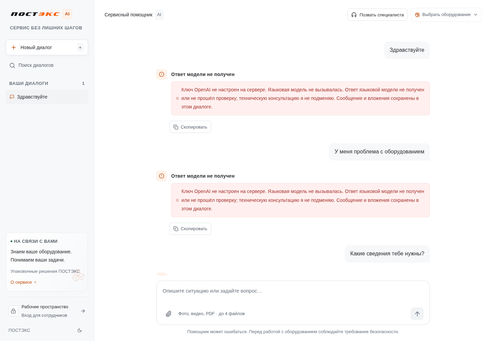
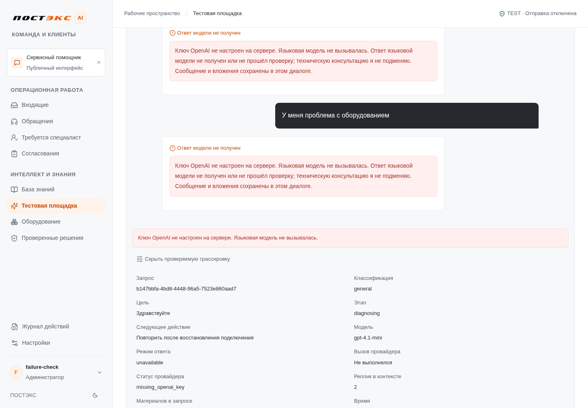
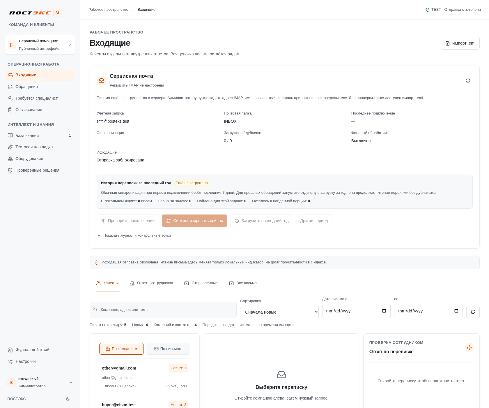
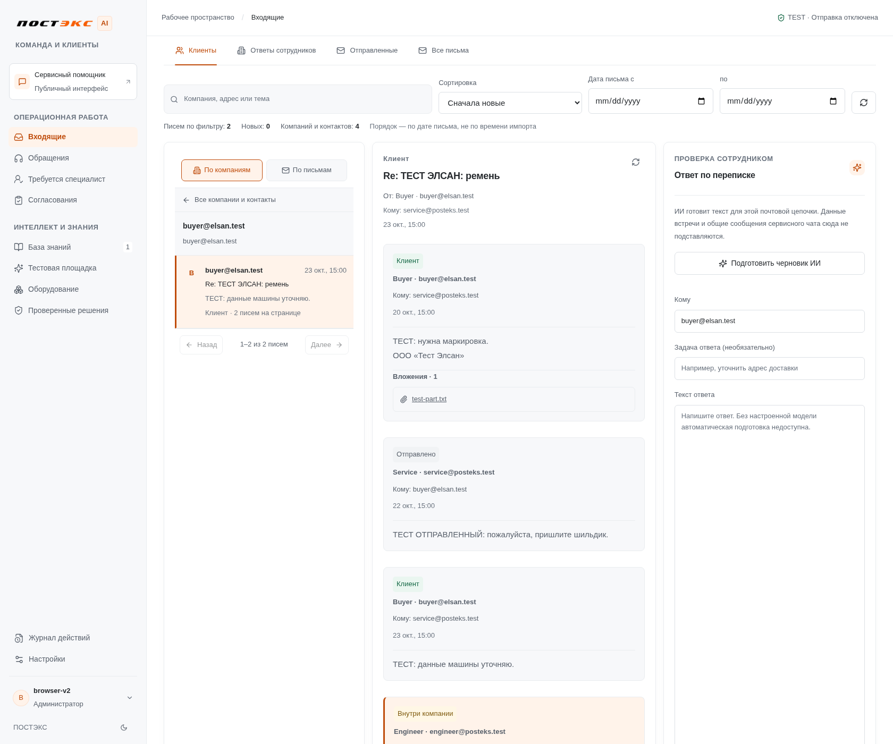
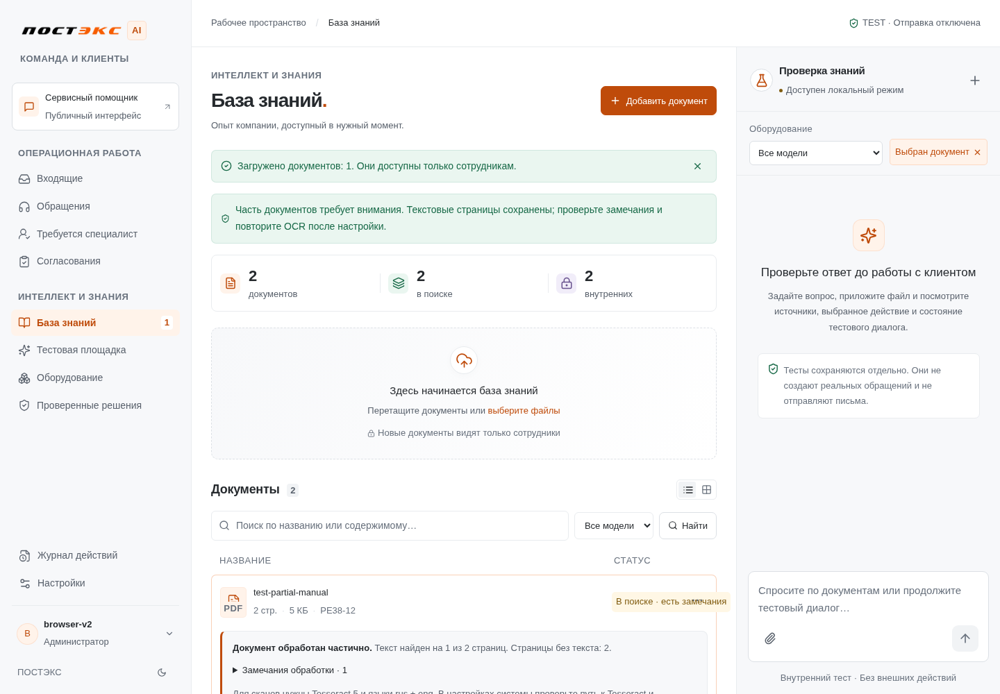

# Интерфейс проверочной сборки

## Честная ошибка модели и сохранение диалога

Пять реплик отправлены настоящему локальному серверу через браузер. Ключ не настроен: вместо технических заготовок показана недоступность модели. Это проверка обработки ошибки, а не демонстрация качества работающего ИИ. Дизайн сохранён.

Это снимки работающего веб-приложения с настоящим локальным backend и отдельной тестовой БД. Письма и PDF в этих проверках искусственные; реальные документы и переписка компании на снимки не попадали. Подключение к Яндексу здесь не настроено, поэтому состояние подключения показано честно.

Для интерактивной проверки установите программу и запустите `start.bat`, затем `open-app.bat`. Порядок обновления с сохранением своих данных — в [инструкции Windows](../TESTING_GUIDE_RU.md).

## Входящие: компании, категории и даты

## Цепочка клиента, исходящие и ответ сотрудника

## Читаемая часть PDF сохраняется при ошибке OCR

